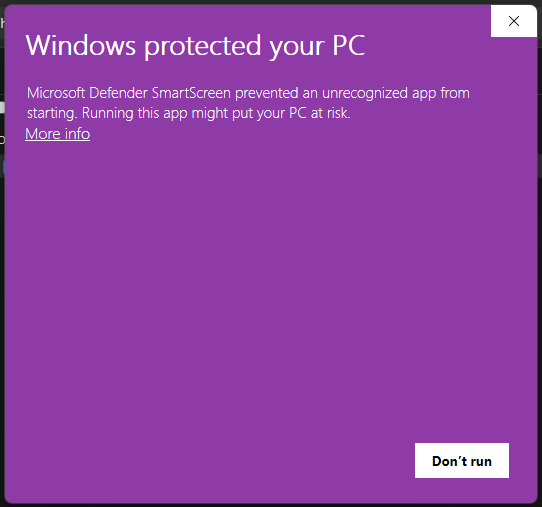
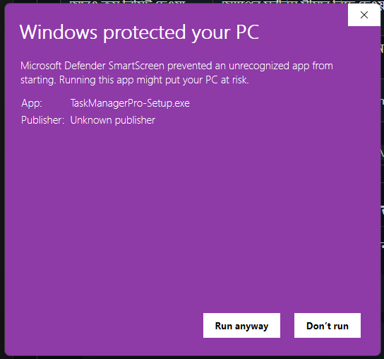
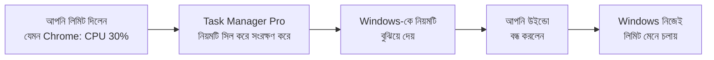
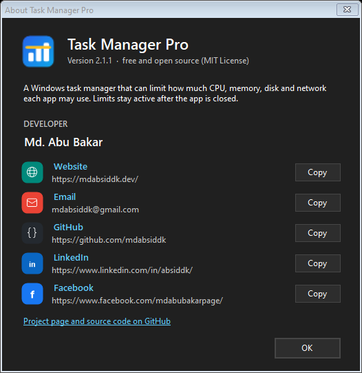

# Task Manager Pro

[](https://github.com/mdabsiddk/Task-Manager-Pro/actions/workflows/build.yml)
[](https://github.com/mdabsiddk/Task-Manager-Pro/releases/latest)
[](https://github.com/mdabsiddk/Task-Manager-Pro/releases)
[](LICENSE)
[](#-যা-যা-লাগবে)

[](https://github.com/mdabsiddk/Task-Manager-Pro/releases/latest/download/TaskManagerPro-Setup.exe)

**সম্পূর্ণ ফ্রি ও ওপেন সোর্স।** কোনো সাবস্ক্রিপশন বা ফি নেই, কখনো লাগবে না।

Windows 11 Task Manager-এর মতো দেখতে একটি টাস্ক ম্যানেজার। এতে প্রতিটি অ্যাপের **CPU, মেমোরি, ডিস্ক ও নেটওয়ার্ক ব্যবহারের সর্বোচ্চ লিমিট** বেঁধে দেওয়া যায়।
লিমিট সেট করে অ্যাপটি বন্ধ করে দিলেও লিমিট চালু থাকে।


> 📘 পূর্ণ ইংরেজি ডকুমেন্টেশন: [docs/README.en.md](docs/README.en.md) · টেকনিক্যাল ডিজাইন: [docs/ARCHITECTURE.md](docs/ARCHITECTURE.md)

---

## ✅ যা যা লাগবে

- Windows 10 বা 11
- Administrator অনুমতি (ইনস্টলের সময় একবার **Yes** চাপতে হবে)
- আর কিছু ইনস্টল করতে হবে না। .NET Framework Windows-এর সাথেই থাকে।

---

## 📥 ইনস্টল

### পদ্ধতি ১: এক লাইনের PowerShell কমান্ড (প্রস্তাবিত)

**PowerShell** খুলুন। Start-এ `PowerShell` লিখে খুলতে পারেন; Administrator হিসেবে খোলার দরকার নেই। তারপর নিচের কমান্ডটি চালান:

```powershell
irm https://raw.githubusercontent.com/mdabsiddk/Task-Manager-Pro/main/install.ps1 | iex
```

- অনুমতি চাইলে **Yes** দিন।
- কমান্ডটি GitHub থেকে সর্বশেষ ভার্সন ডাউনলোড করে, **SHA-256 checksum দিয়ে যাচাই করে**, তারপর ইনস্টল করে।
- একই কমান্ড আবার চালালে **আপডেট** হয়। আপনার লিমিট ও সেটিংস থেকে যায়।

### পদ্ধতি ২: সরাসরি ইনস্টলার ডাউনলোড

| ফাইল | কীভাবে ব্যবহার করবেন |
|---|---|
| ⬇️ [**TaskManagerPro-Setup.exe**](https://github.com/mdabsiddk/Task-Manager-Pro/releases/latest/download/TaskManagerPro-Setup.exe) | ডাউনলোড করে ডাবল-ক্লিক করুন → **Yes** |
| ⬇️ [**TaskManagerPro.zip**](https://github.com/mdabsiddk/Task-Manager-Pro/releases/latest/download/TaskManagerPro.zip) | Extract করুন → **`install.bat`**-এ ডাবল-ক্লিক → **Yes** |

সব ভার্সন ও checksum পাবেন [Releases](https://github.com/mdabsiddk/Task-Manager-Pro/releases) পেজে।

### ⚠️ ইনস্টলের সময় যে স্ক্রিনগুলো আসবে

| ধাপ | স্ক্রিনে যা দেখবেন | যা করবেন |
|:-:|---|---|
| 1 | ব্রাউজারে: *"isn't commonly downloaded"* | **Keep** |
| 2 | **Windows protected your PC** | **More info** |
| 3 | *App: TaskManagerPro-Setup.exe · Publisher: Unknown publisher* | **Run anyway** |
| 4 | **User Account Control:** *Do you want to allow…?* | **Yes** |
| 5 | কালো উইন্ডোতে `[SUCCESS]` | যেকোনো কী চাপুন |

| ধাপ ২: **More info** চাপুন | ধাপ ৩: **Run anyway** চাপুন |
|:-:|:-:|
|  |  |

> **কেন এই সতর্কবার্তা আসে?** নতুন এবং কোড-সাইন ছাড়া (*Unknown publisher*) প্রতিটি অ্যাপেই Windows এটি দেখায়। এটা ভাইরাসের সংকেত নয়।
> সোর্স কোড এখানেই খোলা আছে, আর প্রতিটি ফাইল `SHA256SUMS.txt` দিয়ে যাচাই করা যায়।
> PowerShell কমান্ড দিয়ে ইনস্টল করলে শুধু ধাপ ৪ (**Yes**) আসে।

### পদ্ধতি ৩: সোর্স কোড থেকে

```powershell
git clone https://github.com/mdabsiddk/Task-Manager-Pro.git
```
```powershell
Start-Process -FilePath ".\Task-Manager-Pro\install.bat" -Verb RunAs -Wait
```

### ইনস্টল হয়েছে কিনা দেখুন

```powershell
Test-Path "$env:ProgramFiles\TaskManagerPro\TaskManagerPro.exe"
```

`True` দেখালে ইনস্টল সফল হয়েছে।

**ইনস্টলার যা করে:**
- `C:\Program Files\TaskManagerPro`-এ কপি করে
- Desktop ও Start menu-তে শর্টকাট বানায়
- **Settings → Apps**-এ এন্ট্রি যোগ করে

---

## 🔄 আপডেট

| | |
|---|---|
| **নিজে থেকে** | সপ্তাহে একবার (ইন্টারনেট থাকলে) GitHub-এ নতুন ভার্সন খোঁজে। **পেলে নিজেই আপডেট হয়, না পেলে কিছুই হয় না।** পিসি বন্ধ থাকলে পরের বার চালু হওয়ার পর খোঁজে। |
| **নিজে চেক করতে** | **••• → Updates → Check for updates now** |
| **নতুন ভার্সন থাকলে** | উইন্ডোর উপরে নীল বার দেখায় → **Update now** |
| **আগে জিজ্ঞেস করুক** | **••• → Updates → Ask before updating** |
| **স্বয়ংক্রিয় আপডেট বন্ধ** | **••• → Updates → Check for updates every week** (টিক তুলে দিন) |

- আপডেট আসে শুধু এই রিপোর [Releases](https://github.com/mdabsiddk/Task-Manager-Pro/releases) থেকে, আর **SHA-256 checksum মিললেই** ইনস্টল হয়।
- আপনার লিমিট ও সেটিংস থেকে যায়।
- আপডেটের সময় আবার অনুমতি চাওয়া হয় না।
- v2.0.x থেকে একবার হাতে আপডেট করতে হবে (উপরের ইনস্টল কমান্ড আবার চালান)। এরপর থেকে নিজে নিজেই আপডেট হবে।

---

## 🖱️ ব্যবহার (সংক্ষেপে)

| কাজ | কীভাবে |
|---|---|
| লিমিট দেওয়া | অ্যাপের সারিতে **Max CPU / Max memory / Max disk / Max network** ঘরে একবার ক্লিক করুন → সংখ্যা লিখুন → **Enter** |
| লিমিট তুলে দেওয়া | ঘরটি খালি করুন, অথবা রাইট-ক্লিক → **Remove limits** |
| সাব-প্রসেস দেখা | অ্যাপের পাশের **›** চিহ্নে ক্লিক করুন |
| প্রসেস বন্ধ করা | সারি সিলেক্ট করে **End task** বা `Delete` |
| সব লিমিট সাময়িক বন্ধ | উপরের **Pause limits** বোতাম |

- **অ্যাপ বন্ধ করলে বা কম্পিউটার রিস্টার্ট করলেও লিমিট চালু থাকে।**
- লিমিট সেট থাকলে ট্রেতে একটি খুব ছোট ইঞ্জিন চলে (কয়েক MB RAM, CPU প্রায় শূন্য)। কোনো লিমিট না থাকলে কিছুই চলে না।
- এটি বন্ধ করতে চাইলে: **••• → Keep limits after closing and restart** (টিক তুলে দিন)।
- **প্রতিটি অ্যাপের একটি সর্বনিম্ন লিমিট আছে:** অ্যাপটি এখন যা ব্যবহার করছে তার এক-চতুর্থাংশ (২৫%), যাতে অ্যাপ চালু হতে সমস্যা না হয়। মেমোরিতে Windows-এর নিজস্ব সীমাও আছে: প্রতিটি প্রসেসের জন্য অন্তত ৩২ MB।
- এর চেয়ে কম লিখে সেভ করতে চাইলে একটি নোটিশে ঠিক সর্বনিম্ন মান দেখায়, যেমন: *The lowest memory limit for Electron is 128 MB (32 MB for each of its 4 processes).*
- **সব নোটিশ** স্ক্রিনের নিচে ডান কোণে একটি কার্ডে দেখায়। আইকনের চারপাশের গোল দাগটি দেখায় কার্ডটি আর কতক্ষণ থাকবে (৩ সেকেন্ড; মাউস রাখলে থেমে থাকে)। **✕** চাপলে সাথে সাথে বন্ধ হয়।

---

## ⚙️ এটি কীভাবে কাজ করে (সহজ ভাষায়)

Task Manager Pro নিজে পাহারা দিয়ে বসে থাকে না। আপনি যে লিমিট দেন, সেটি এটি **Windows-কেই বুঝিয়ে দেয়**। এরপর Windows নিজেই অ্যাপটিকে সেই সীমার মধ্যে রাখে। তাই উইন্ডো বন্ধ করে দিলেও লিমিট কাজ করতে থাকে।



### ১. দেখা: কোন অ্যাপ কতটা ব্যবহার করছে

- Windows-এর কাছ থেকে **একবারেই সব প্রসেসের হিসাব** নেয়: CPU, মেমোরি ও ডিস্ক। নেটওয়ার্কের হিসাব আসে Windows-এর নিজস্ব ইভেন্ট থেকে।
- একই অ্যাপের সব প্রসেস (যেমন Chrome-এর অনেকগুলো ট্যাব-প্রসেস) **একটি অ্যাপ হিসেবে একসাথে** দেখায়, ঠিক Windows Task Manager-এর মতো।
- **প্রতিটি অ্যাপের নাম ও আইকন** Windows Task Manager-এর মতো করেই খুঁজে নেয়:
  - সাধারণ অ্যাপ: প্রোগ্রাম ফাইলের ভেতরের আইকন ও নাম।
  - Microsoft Store-এর অ্যাপ (WhatsApp, Photos, Settings ইত্যাদি): Start menu-তে যে নাম ও লোগো দেখায়, সেটাই।
  - সুরক্ষিত প্রসেস (যেমন Microsoft Defender): এগুলো খোলা যায় না, তবুও Windows-এর কাছ থেকে ফাইলের ঠিকানা জেনে আইকন বের করে।
- লিমিট দিলে সেটি **পুরো অ্যাপে** কাজ করে, তার সব সাব-প্রসেস সহ।

### ২. লিমিট: কোনটা কীভাবে আটকানো হয়

| জিনিস | যা করা হয় | সহজ কথায় ফলাফল |
|---|---|---|
| **CPU** | অ্যাপটিকে Windows-এর একটি "বাক্সে" (Job Object) রেখে সর্বোচ্চ % বেঁধে দেওয়া হয় | অ্যাপ যত চেষ্টাই করুক, ঠিক করা ভাগের বেশি CPU পাবে না |
| **মেমোরি** | লিমিটটি পুরো অ্যাপের জন্য একটি বাজেট (সব প্রসেস মিলিয়ে) | লিমিটের নিচে থাকলে অ্যাপ পুরো গতিতে চলে। লিমিট ছাড়ালে বাড়তি অংশ Windows সরিয়ে রাখে; অ্যাপ বন্ধ হয় না |
| **ডিস্ক** | অ্যাপের ডিস্ক-অগ্রাধিকার কমানো হয় | অন্য অ্যাপ আগে ডিস্ক পায়। সীমা ছাড়ালে অ্যাপটি আরও পিছনে চলে যায় |
| **নেটওয়ার্ক** | Windows-এর নেটওয়ার্ক নিয়ম (QoS) বানানো হয় | আপলোডের গতি সীমার মধ্যে থাকে (ডাউনলোড Windows আটকাতে পারে না) |

**মেমোরি লিমিট কীভাবে ভাগ হয়:** Chrome-এর মতো অ্যাপ অনেকগুলো প্রসেস চালায়। লিমিট (যেমন ১০০০ MB) সবার মধ্যে সমান ভাগ হয় না; যে প্রসেস বেশি ব্যবহার করছে সে বেশি পায়।
- অ্যাপের মোট মেমোরি লিমিটের নিচে থাকলে কোনো বাধা নেই।
- বাধা কাজ করে **শুধু তখনই, যখন অ্যাপ লিমিট পার হতে চায়।** তখন প্রতিটি প্রসেস তার ব্যবহারের অনুপাতে ভাগ পায়, আর সব ভাগ মিলিয়ে ঠিক পুরো লিমিট। ফলে অ্যাপ কখনো লিমিটের চেয়ে কমে আটকে থাকে না।
- ব্যবহার কমে লিমিটের **২০%-এর নিচে** নামলে বাধা পুরোপুরি উঠে যায়।

### ৩. উইন্ডো বন্ধ করলেও লিমিট কেন থাকে

- উপরের নিয়মগুলো থাকে **Windows-এর ভেতরে, অ্যাপের গায়ে লাগানো অবস্থায়**। উইন্ডো বন্ধ করলে Task Manager Pro পুরোপুরি বন্ধ হয়ে যায়, কিন্তু নিয়ম থেকে যায়।
- **পরে নতুন করে খোলা অ্যাপ:** Windows অ্যাপটি চালু হওয়ার মুহূর্তেই কম অগ্রাধিকার দেয়, আর নেটওয়ার্ক নিয়ম সবসময় চালু থাকে।
- **হুবহু CPU ও মেমোরি লিমিটের জন্য** লিমিট সেট থাকলে একটি খুব ছোট ইঞ্জিন চলে:
  - এটি মাত্র ০.২–৩.৫ MB RAM নেয়।
  - এটি বারবার কিছু চেক করে না। কোনো অ্যাপ চালু হলে Windows এটিকে জানায়, আর এক সেকেন্ডেরও কম সময়ে লিমিট বসে যায়।
  - কোনো লিমিট না থাকলে ইঞ্জিন চলে না; শেষ লিমিটটি তুলে দিলে নিজেই বন্ধ হয়ে যায়।

### কম্পিউটার রিস্টার্ট করলে কী হয়

- রিস্টার্টে সব অ্যাপ নতুন করে চালু হয়, তাই অ্যাপের গায়ে লাগানো লিমিট মুছে যায়।
- সাইন-ইন করার সাথে সাথে Windows নিজেই ইঞ্জিনটি চালু করে (কোনো অনুমতি চাওয়া ছাড়া)। ইঞ্জিন চালু থাকা অ্যাপ আর পরে খোলা সব অ্যাপে আবার লিমিট বসিয়ে দেয়।
- পরীক্ষায় দেখা গেছে: ২০% CPU লিমিট দেওয়া অ্যাপ রিস্টার্টের পরেও ২২% এর মধ্যে ছিল; ইঞ্জিন ছাড়া একই অ্যাপ ৯৬% নিচ্ছিল।

### ৪. যাতে কোনো ক্ষতি না হয়

- **সর্বনিম্ন সীমা অ্যাপ নিজেই ঠিক করে দেয়:** অ্যাপটি এখন (বা সাধারণত) যা ব্যবহার করে, তার এক-চতুর্থাংশের (২৫%) নিচে লিমিট দেওয়া যায় না, তাই অ্যাপ চালু হতে পারে।
- **বাইরের কেউ লিমিট বদলাতে পারে না:** লিমিট ফাইল সিল করা থাকে, আর সেটিংস ফোল্ডার শুধু Administrator বদলাতে পারে (বিস্তারিত: [নিরাপত্তা](#️-নিরাপত্তা))।
- **সব কিছু ফেরানো যায়:** কোনো ড্রাইভার বসানো হয় না, কোনো অ্যাপ জোর করে থামানো হয় না। লিমিট তুলে দিলে বা **Pause limits** চাপলে অ্যাপ আগের মতো হয়ে যায়।

### ৫. কোথায় কী থাকে

| জিনিস | জায়গা |
|---|---|
| প্রোগ্রাম (একটিই ফাইল) | `C:\Program Files\TaskManagerPro\TaskManagerPro.exe` |
| লিমিট ও সেটিংস | `C:\ProgramData\TaskManagerPro\` |
| সাইন-ইনে চালু হওয়া ও সাপ্তাহিক আপডেট | Windows **Task Scheduler** (*TaskManagerPro*, *TaskManagerPro Update*) |

---

## 🗑️ আনইনস্টল

### পদ্ধতি ১: Windows Settings

**Settings → Apps → Installed apps → Task Manager Pro → Uninstall**

### পদ্ধতি ২: এক লাইনের PowerShell কমান্ড

```powershell
irm https://raw.githubusercontent.com/mdabsiddk/Task-Manager-Pro/main/uninstall.ps1 | iex
```

অথবা ইনস্টল করা ফোল্ডার থেকে সরাসরি:

```powershell
Start-Process -FilePath "$env:ProgramFiles\TaskManagerPro\uninstall.bat" -Verb RunAs -Wait
```

**আনইনস্টলার যা করে:**
- সব অ্যাপ আগের স্বাভাবিক অবস্থায় ফিরিয়ে দেয়
- সব লিমিট, শর্টকাট ও প্রোগ্রাম ফাইল মুছে ফেলে
- সাপ্তাহিক আপডেট চেকও বন্ধ করে দেয়
- **সেভ করা লিমিট রাখবেন কিনা** জিজ্ঞেস করে: রাখতে **N**, মুছতে **Y** চাপুন

মুছে গেছে কিনা দেখতে:

```powershell
Test-Path "$env:ProgramFiles\TaskManagerPro"
```

`False` দেখালে আনইনস্টল সম্পূর্ণ হয়েছে।

---

## 🚨 জরুরি অবস্থা: সব অ্যাপ এক ক্লিকে স্বাভাবিক করুন

লিমিটের কারণে কোনো অ্যাপ ঠিকমতো না চললে Task Manager Pro খুলে উপরের **Pause limits** বোতাম চাপুন।

উইন্ডো খোলা না গেলে PowerShell-এ:

```powershell
& "$env:ProgramFiles\TaskManagerPro\TaskManagerPro.exe" --restore-all
```

এতে সব অ্যাপ সাথে সাথে স্বাভাবিক হয় এবং লিমিট বিরতিতে চলে যায়। আপনার লিমিটগুলো মুছে যায় না। পরে **Resume limits** চাপলে আবার চালু হবে।

---

## ⌨️ দরকারি কমান্ড

| কাজ | PowerShell কমান্ড |
|---|---|
| অ্যাপ খোলা | `& "$env:ProgramFiles\TaskManagerPro\TaskManagerPro.exe"` |
| Task Manager Pro বন্ধ (উইন্ডো + ইঞ্জিন; লিমিট থেকে যাবে) | `& "$env:ProgramFiles\TaskManagerPro\TaskManagerPro.exe" --exit` |
| সব অ্যাপ স্বাভাবিক + লিমিট বিরতি | `& "$env:ProgramFiles\TaskManagerPro\TaskManagerPro.exe" --restore-all` |
| শুধু বিল্ড (ডেভেলপারদের জন্য) | `Start-Process ".\build.bat" -Wait` |
| রিলিজ ফাইল বানানো (Setup.exe + zip) | `powershell -ExecutionPolicy Bypass -File .\tools\make-release.ps1` |

---

## 🛡️ নিরাপত্তা

- **Windows-এর গুরুত্বপূর্ণ প্রসেসে** (Explorer, svchost ইত্যাদি) লিমিট দেওয়া যায় না।
- **সেটিংস ফোল্ডার** (`C:\ProgramData\TaskManagerPro`) শুধু Administrator পরিবর্তন করতে পারে।
- **লিমিট ফাইল সিল করা থাকে।** অন্য কোনো প্রোগ্রাম বদলালে লিমিট প্রয়োগ হয় না। তখন উপরে একটি **হলুদ বার** দেখায়, আর আপনি **Review limits** চেপে নিশ্চিত না করা পর্যন্ত কিছু হয় না।

---

## ❓ সমস্যা ও সমাধান

| সমস্যা | সমাধান |
|---|---|
| খোলার সময় অনুমতি চায় | স্বাভাবিক। অন্য অ্যাপ নিয়ন্ত্রণ করতে Administrator অনুমতি লাগে |
| আরও কম লিমিট দেওয়া যাচ্ছে না | অ্যাপের সর্বনিম্ন সীমার নিচে দেওয়া যায় না। ঘরে ক্লিক করলে সর্বনিম্ন মান দেখায় |
| হলুদ বার দেখাচ্ছে | লিমিট ফাইল বাইরে থেকে বদলানো হয়েছে। **Review limits** চেপে দেখে নিন |
| ডাউনলোডে নেটওয়ার্ক লিমিট কাজ করে না | Windows শুধু আপলোড (outgoing) গতি নিয়ন্ত্রণ করতে পারে |
| কোনো এরর হয়েছে | Administrator হিসেবে `C:\ProgramData\TaskManagerPro\error.log` ফাইলটি দেখুন |

---

## 🚀 নতুন ভার্সন প্রকাশ (মেইনটেইনারদের জন্য)

ভার্সন নম্বর থাকে **শুধু একটি জায়গায়: রুট ফোল্ডারের [`VERSION`](VERSION) ফাইলে।** সফটওয়্যার (About, ট্রে, আপডেট), Setup.exe, *Installed apps*, GitHub Release ও README-র ব্যাজ সবাই এখান থেকেই ভার্সন নেয়।

1. নতুন ভার্সন সেট করুন (এতে `CHANGELOG.md`-এ একটি শিরোনামও যোগ হয়):
   ```powershell
   powershell -ExecutionPolicy Bypass -File .\tools\set-version.ps1 2.3.0
   ```
2. `CHANGELOG.md`-এ কী কী বদলেছে লিখুন।
3. কমিট করে `main`-এ পুশ করুন। **GitHub Actions** নিজে থেকেই `v2.3.0` ট্যাগ বানিয়ে `TaskManagerPro-Setup.exe`, `TaskManagerPro.zip` ও `SHA256SUMS.txt` সহ নতুন Release প্রকাশ করবে। এরপর ইনস্টল করা সব কপি সাপ্তাহিক চেকে নিজে নিজেই আপডেট হয়ে যাবে।

---

## 📄 লাইসেন্স

**[MIT License](LICENSE).** Task Manager Pro সবার জন্য **সম্পূর্ণ ফ্রি**:
- কোনো সাবস্ক্রিপশন, ফি বা লুকানো খরচ নেই।
- ব্যক্তিগত ও বাণিজ্যিক যেকোনো কাজে ব্যবহার করা যাবে।
- সোর্স কোড পরিবর্তন করে নিজের মতো করে নেওয়া এবং অন্যকে দেওয়া যাবে। শুধু লাইসেন্স ও কপিরাইট নোটিশটি রেখে দিতে হবে।
- সফটওয়্যারটি "যেমন আছে" (as is) দেওয়া হচ্ছে, কোনো ওয়ারেন্টি ছাড়া।

---

## 👨‍💻 ডেভেলপার

**Md. Abu Bakar**

| | |
|---|---|
| 🌐 ওয়েবসাইট | [mdabsiddk.dev](https://mdabsiddk.dev/) |
| ✉️ ইমেইল | [mdabsiddk@gmail.com](mailto:mdabsiddk@gmail.com) |
| 🐙 GitHub | [github.com/mdabsiddk](https://github.com/mdabsiddk) |
| 💼 LinkedIn | [linkedin.com/in/absiddk](https://www.linkedin.com/in/absiddk/) |
| 📘 Facebook | [facebook.com/mdabubakarpage](https://www.facebook.com/mdabubakarpage/) |

অ্যাপের ভেতরেও **••• → About Task Manager Pro**-এ এই তথ্যগুলো দেখা যায়।



