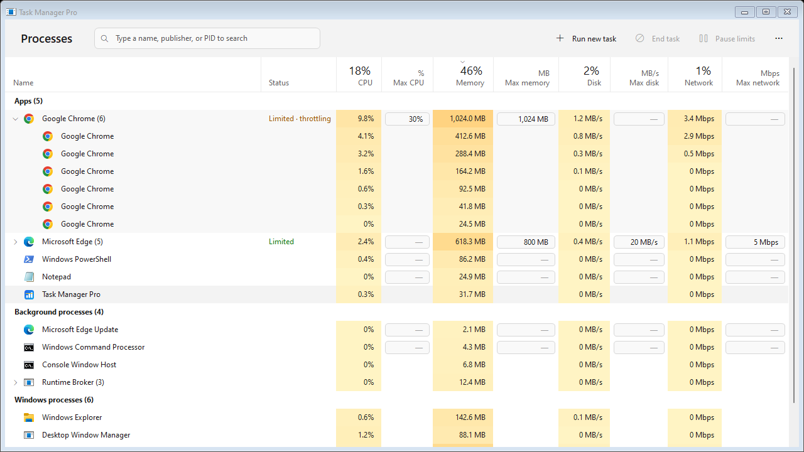
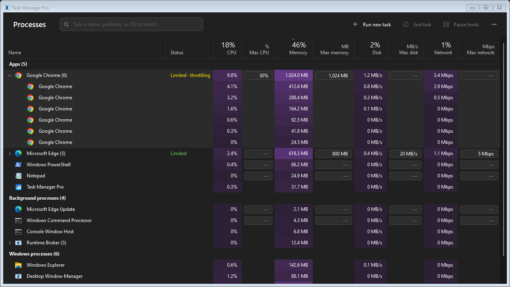

# Task Manager Pro v2.0 (English)

> বাংলা সংক্ষিপ্ত গাইড: [README.md](../README.md)

A Windows task manager that looks and works like the Windows 11 Task Manager, and can also **limit how much CPU, memory, disk and network each app may use**.

Set a limit, close the window, and you're done. **Nothing has to keep running in the background**: the limits stay on the apps.

| Light | Dark |
|---|---|
|  |  |

| | |
|---|---|
| **Version** | 2.0.0 ([changelog](../CHANGELOG.md)) |
| **Platform** | Windows 10 / 11 (Windows 8/8.1 work too) |
| **Runtime** | .NET Framework 4.x. It ships with Windows, so there is nothing to install |
| **Background cost** | **None** by default. The optional background engine uses 0.2–3.5 MB of RAM and about 0% CPU |

---

## Contents

- [Features](#features)
- [Install](#install)
- [Using it](#using-it)
- [How limits work](#how-limits-work)
- [Closing the app and running in the background](#closing-the-app-and-running-in-the-background)
- [Safety](#safety)
- [Protection against misuse](#protection-against-misuse)
- [Project structure](#project-structure)
- [Where data is stored](#where-data-is-stored)
- [Uninstall](#uninstall)
- [FAQ](#faq)
- [Known limitations](#known-limitations)

---

## Features

### The Task Manager you know
- **Processes view** grouped like Task Manager: **Apps**, **Background processes** and **Windows processes**, each with a count.
- **App trees with icons.** An app row such as *Google Chrome (13)* expands with ▸ to show every sub-process: renderers, helpers, and the *PowerShell* or *Console Window Host* an app started.
  - Each app and each sub-process shows its real name and icon.
- **Columns:** Name · Status · CPU · Memory · Disk · Network.
- **Total usage in the column headers,** like Task Manager: *14% CPU*, *81% Memory*, *4% Disk*, *0% Network*.
- **Heat-map cells:** the busier an app, the stronger its colour (yellow in the light theme, purple in the dark theme).
- **Sorting:** click any column header to sort; click again to reverse the order.
- **Resizable columns:** drag a header border. Widths, sort order and window position are remembered.
- **Search** (`Ctrl+F` / `Ctrl+E`): by app name, publisher description or PID.
- **End task** on an app ends all of its processes. **End task** on a sub-process ends only that process.
  - Use the toolbar button, the right-click menu or the `Delete` key.
- **Right-click menu:** Expand/Collapse · Switch to · End task · Set limits · Remove limits · Open file location · Properties.
- **Run new task** opens the standard Windows *Run* dialog.
- **Follows the Windows theme automatically.** Dark mode opens dark, light mode opens light, and it switches live when you change the Windows setting.
  - This includes the title bar, scroll bars and menus.
  - You can also force Light or Dark under *Options → Theme*.
- **High-DPI aware;** text stays crisp at 125–200% scaling.

### Limits, in a "Max" column next to each usage column

| Column | Meaning | Enforced with |
|---|---|---|
| **Max CPU** (%) | Highest share of the whole CPU the app may use | Windows Job Object **CPU hard cap** (exact), plus BelowNormal priority |
| **Max memory** (MB) | Most RAM the app may keep | Hard working-set maximum: extra pages go to the page file, **the app does not crash** |
| **Max disk** (MB/s) | Disk read + write | Low I/O priority; Very low (plus Idle priority) while over the limit |
| **Max network** (Mbps) | Upload speed | Windows Policy-based QoS (`New-NetQosPolicy`) |

- **Each app has its own lowest allowed limit,** worked out from the app's own usage (see [Protection against misuse](#protection-against-misuse)). Opening a Max box shows that minimum.
- **One click to type.** Click a Max cell, type a number and press `Enter`.
  - `Tab` moves to the next Max cell.
  - `Esc` cancels.
  - Leave the cell empty, or type 0, for no limit.
- Limits apply to the **whole app**: every process in its tree, including ones it starts later.
- The **Status** column shows *Limited*, *Limited · throttling*, *Access denied* or *Limits paused*.
- **Pause limits** (toolbar) temporarily puts every app back to normal and keeps your settings.
- **Remove limits** (right-click) or **Remove all limits** (*Options*) undo everything immediately.

---

## Install

### From GitHub (recommended)

**One command**, in PowerShell (no need to open it as administrator; Windows asks once):
```powershell
irm https://raw.githubusercontent.com/mdabsiddk/Task-Manager-Pro/main/install.ps1 | iex
```
It downloads the latest release, verifies its SHA-256 checksum, and installs it. Running it again updates the app.

**Direct downloads** (always the newest release):
- [TaskManagerPro-Setup.exe](https://github.com/mdabsiddk/Task-Manager-Pro/releases/latest/download/TaskManagerPro-Setup.exe): a single-file installer. Double-click it and answer Yes.
- [TaskManagerPro.zip](https://github.com/mdabsiddk/Task-Manager-Pro/releases/latest/download/TaskManagerPro.zip): extract it and double-click `install.bat`.

> The files are not code-signed, so SmartScreen may warn: click **More info → Run anyway**. Checksums are in `SHA256SUMS.txt` on the [Releases](https://github.com/mdabsiddk/Task-Manager-Pro/releases) page.

### From the source folder

1. Keep the whole project folder together.
2. Double-click **`install.bat`** and answer **Yes** to the Windows permission prompt.
3. The installer then:
   - builds the program with the C# compiler that comes with Windows
   - installs it to `C:\Program Files\TaskManagerPro`
   - pre-compiles it to native code (faster start, lower memory)
   - creates Desktop and Start menu shortcuts
   - adds an entry to **Settings → Apps → Installed apps**
   - starts it

**Upgrading:**
- From an earlier Task Manager Pro: run `install.bat` again. Your limits and settings are kept.
- From **Smart Task Manager** (the previous name): the installer removes it and moves your limits over.

### Publishing a new version (maintainers)
1. Raise the version in `src\AssemblyInfo.cs`.
2. Run `git tag v2.0.1` and then `git push origin v2.0.1`.
3. GitHub Actions builds `TaskManagerPro-Setup.exe`, `TaskManagerPro.zip` and `SHA256SUMS.txt` and publishes the release. The download links above always point to the newest one.

To build the same files locally, run `.\tools\make-release.ps1` (the output goes to `dist\`).

### Build only (developers)
```bash
build.bat
```
The output goes to `build\TaskManagerPro.exe` (plus `TaskManagerPro.exe.config`).

### Command line
| Argument | What it does |
|---|---|
| *(none)* | Opens the window. If Task Manager Pro is already running, it is brought to the front |
| `--engine` | Starts the background engine (tray icon) |
| `--autostart` | Used by the sign-in task: starts the engine if *Run in background* is on |
| `--exit` | Closes Task Manager Pro (window and background engine). Limits stay on the apps |
| `--release-all` | Restores every limited app and removes all persistent limits (used by the uninstaller) |

---

## Using it

### Setting a limit
1. Find the app (use the search box if needed). Limits are set on the **app row**, not on its sub-processes.
2. Click the box in **Max CPU**, **Max memory**, **Max disk** or **Max network**.
3. Type a number and press **Enter**. The limit is saved and applied immediately.

**Examples:**
- Type `30` in Google Chrome's **Max CPU**: all of Chrome together can never use more than 30% of the CPU.
- Type `1024` in **Max memory**: Chrome keeps at most about 1 GB in RAM.

Invalid input is rejected with a message, and nothing is saved:
- letters, negative numbers, or CPU over 100%
- **a value below the app's own minimum.** For example: *"The lowest memory limit for Google Chrome is 624 MB (half of what it normally uses, about 1,240 MB of memory)."*

### Keyboard
| Key | Action |
|---|---|
| `Ctrl+F` / `Ctrl+E` | Search |
| `Esc` (in search) | Clear the search |
| `↑ ↓ PgUp PgDn Home End` | Move the selection |
| `→` / `←` | Expand / collapse an app, or go to its parent |
| `Enter` | Expand / collapse |
| `Delete` | End task |
| `F5` | Refresh now |
| `Enter` / `Tab` / `Esc` (while typing a limit) | Save / save and go to the next Max cell / cancel |

---

## How limits work

Every limit uses a documented Windows mechanism. There are no drivers, no suspended threads and no blocked memory allocations, so apps don't crash. Everything can be undone.

| | Running apps | Apps started later, with nothing of ours running | Apps started later, with the background engine |
|---|---|---|---|
| **CPU** | Exact hard cap (Job Object) | Lower CPU priority (Windows *PerfOptions*) | Exact hard cap |
| **Memory** | Hard working-set limit | Lower memory priority (trimmed first under pressure) | Hard working-set limit |
| **Disk** | Low I/O priority | Low I/O priority | Low I/O priority |
| **Network** | Windows QoS policy | Windows QoS policy | Windows QoS policy |

- **Running apps:** the limits are kernel settings on the processes themselves, so they keep working after Task Manager Pro is closed, until the app exits. Child processes the app starts later are included automatically, because they join the same job.
- **Apps started later:** Windows itself reads the app's *Image File Execution Options → PerfOptions* registry values every time the program starts. The network QoS policy also stays in Windows, even after a restart.
- **Exact caps for apps started later:** turn on *Options → Run in background*. A small engine waits in the tray. Windows notifies it (through ETW) the moment a process starts; it applies the limits within about 0.6 seconds (measured) and goes back to sleep.

Technical details are in [docs/ARCHITECTURE.md](ARCHITECTURE.md).

---

## Closing the app and running in the background

- **Close (×):** the window process ends completely and frees all of its memory.
  - Your limits **stay applied** to the running apps.
  - Apps you open later start with lower priorities and the network limit.
- **Options → Run in background** (off by default):
  - After you close the window, a tiny engine stays in the tray. It also starts with Windows, without a UAC prompt.
  - It applies the exact CPU and memory caps to apps you open later.
  - Measured: **0.2–0.6 MB of RAM with no limits set, and up to about 3.5 MB with limits**. It uses no CPU while idle and has no polling loop.
  - Tray icon: click to open the window. Right-click for *Pause all limits* and *Exit*.
- **Limits are only undone by:** *Pause limits*, removing a limit, *Remove all limits*, or uninstalling.

---

## Safety

- **Critical Windows processes** (`System`, `csrss`, `lsass`, `svchost`, `wininit`, `winlogon`, `services`, `smss`…) can't be limited or ended.
- **Other Windows components** (`explorer`, `dwm`, `ctfmon`, Microsoft Defender…) can't be limited. *End task* asks first, like Task Manager does.
- Task Manager Pro never limits or ends itself.
- **Original values are remembered and restored exactly:** priority, core affinity, working set and I/O priority.
  - If an app was limited in an earlier session (after the window was closed), Task Manager Pro recognises it by its job membership and restores Windows defaults.
- **Every action checks the PID and the process start time,** so a recycled PID never hits the wrong program.
- **Registry PerfOptions:** Task Manager Pro marks the values it writes and only removes its own values. It never takes over settings someone else made.

---

## Protection against misuse

A limit tool could be abused: for example, a virus could write tiny limits into the settings so that apps can't even start. Task Manager Pro guards against this in several layers.

### 1. Every app has a minimum, learned from the app itself
We can't know in advance which apps someone uses, so there is **no fixed list of numbers**. Instead:
- **Learning:** while an app runs **without a limit**, Task Manager Pro records what it normally uses: memory, CPU, disk and network.
  - It takes at most one sample every 15 seconds, as a moving average.
  - Apps that have a limit are never sampled, so a limit can't drag its own minimum down.
- **No limit can go below half of the app's normal use.** Example: if Chrome normally uses about 1,240 MB, its memory limit can't be set below 624 MB.
- **Before an app has been learned:** half of what it uses right now is the minimum. With no data at all, only the Windows-level floors apply:
  - CPU: half of one logical processor
  - memory: 32 MB per process (at least 64 MB)
  - disk: 1 MB/s
  - network: about 0.25 Mbps
- **These minimums are enforced everywhere:**
  - when you type a limit
  - every time `limits.cfg` is loaded, so a too-small number in the file is raised
  - inside the limit engine itself
- Windows components (Explorer, the desktop window manager, antivirus, …) can never be limited, even through the file.

### 2. The settings folder is locked
`%ProgramData%\TaskManagerPro` is locked to **Administrators and SYSTEM only**. A program running without administrator rights (most malware) can't read or change anything in it. The folder is locked as soon as Task Manager Pro starts.

### 3. The limits file is sealed
- Every time Task Manager Pro saves `limits.cfg`, it signs it with an HMAC-SHA256 seal made with a secret key that only administrators can read.
- If the file is changed by anything else (another program, malware, or a hand edit), the seal no longer matches, and **none of its limits are applied**.
- A yellow bar then appears in the window: *"The limits file was changed outside Task Manager Pro."* **Review limits** shows what's in it:
  - *Yes* applies it
  - *No* discards it (a copy is kept)
  - *Cancel* decides later
- New limits can't be saved over an unreviewed file.
- The learned-usage file (`profiles.cfg`) is sealed the same way. If it's changed from outside, it is ignored and relearned, so nobody can lower an app's minimum from outside.
- On every start, the registry PerfOptions values and QoS policies are rewritten to match the sealed limits, so a change made there from outside is undone too.

### 4. Emergency switch
If limits ever make apps unusable, use **Start menu → "Task Manager Pro – Restore all apps"** (the same as `TaskManagerPro.exe --restore-all`). It does all of this in one step:
- closes the window
- puts **every app back to normal**
- removes the persistent limits
- pauses all limits

Your limits are kept; click **Resume limits** to use them again.

> **Honest limit of any protection:** a program that already has full administrator rights controls the whole PC and could get around any app's protection. These safeguards stop programs without admin rights completely, make tampering visible, and ensure a bad value can never stop an app from starting.

---

## Project structure

```
Task Manager Pro/
├── README.md              ← short user guide in Bengali (install / uninstall)
├── CHANGELOG.md           ← version history
├── install.ps1            ← one-line installer from GitHub (irm … | iex)
├── uninstall.ps1          ← one-line uninstaller
├── install.bat            ← install (uses the pre-built exe of a release, or builds from source)
├── uninstall.bat          ← complete removal
├── build.bat              ← compile only → build\TaskManagerPro.exe
├── setup/
│   ├── Setup.cs           ← TaskManagerPro-Setup.exe: single-file installer (embedded package)
│   └── setup.manifest
├── tools/
│   └── make-release.ps1   ← builds dist\: Setup.exe, zip, SHA256SUMS.txt, release notes
├── .github/workflows/
│   ├── build.yml          ← builds every push / pull request
│   └── release.yml        ← publishes a GitHub Release when a v*.*.* tag is pushed
├── assets/
│   └── app.ico            ← application icon (16–256 px)
├── src/
│   ├── Program.cs         ← entry point: window / engine / exit / release-all
│   ├── AssemblyInfo.cs    ← version information
│   ├── app.manifest       ← DPI awareness, OS support, common controls
│   ├── app.config         ← .NET runtime settings (low-memory GC)
│   ├── Core/              ← shared by window and engine; mscorlib only (no WinForms)
│   │   ├── NativeMethods.cs     Win32 / NT API declarations
│   │   ├── Models.cs            ProcessRule, ProcInfo, ProcessGroup, ...
│   │   ├── ProcessSampler.cs    CPU / memory / disk of every process in one system call
│   │   ├── ProcessTree.cs       groups processes into apps (like Task Manager)
│   │   ├── ResourceGovernor.cs  applies and restores limits on running processes
│   │   ├── LimitController.cs   rules + running processes + persistent limits in one place
│   │   ├── LimitPolicy.cs       each app's minimum limits (from its own usage)
│   │   ├── AppProfiles.cs       learns what each app normally uses; HMAC seal
│   │   ├── PerfOptions.cs       persistent priorities for apps started later (registry)
│   │   ├── NetworkQos.cs        network limits (Windows QoS policies)
│   │   ├── EtwSession.cs        Event Tracing for Windows consumer (process starts, network)
│   │   ├── Ipc.cs               events + shared memory between window and engine
│   │   ├── RuleStore.cs         limits.cfg
│   │   ├── Settings.cs          settings.cfg, state.cfg, paths, error log
│   │   ├── StartupManager.cs    sign-in task for the background engine
│   │   └── ProtectedProcesses.cs safety lists
│   ├── Engine/
│   │   └── Engine.cs            optional background engine (tray icon, raw Win32)
│   └── UI/
│       ├── UiApp.cs             window process entry
│       ├── MainForm.cs          the window: toolbar, menus, rows, actions
│       ├── ProcessListView.cs   owner-drawn Task Manager style list
│       ├── Controls.cs          toolbar buttons and search box
│       ├── Theme.cs             light/dark palettes, system theme detection
│       ├── ProcessMetadata.cs   app names (descriptions) and icons
│       ├── SystemMonitors.cs    network (ETW), disk active time, window detection
│       └── ProcessActions.cs    End task, Properties, Open file location, Run new task
├── docs/
│   ├── README.en.md       ← this file (full English documentation)
│   ├── ARCHITECTURE.md    ← technical design
│   ├── PROJECT_BRIEF.md   ← requirements and where each is implemented
│   └── screenshot-*.png
└── archive/v1/            ← the original single-file installer (reference)
```

---

## Where data is stored

| File | Location | Contents |
|---|---|---|
| `limits.cfg` | `%ProgramData%\TaskManagerPro\` | Limits: `app\|cpu%\|memoryMB\|diskMBps\|networkKBps`, plus a `#seal:` line |
| `profiles.cfg` | `%ProgramData%\TaskManagerPro\` | What each app normally uses (learned; sealed) |
| `seal.key` | `%ProgramData%\TaskManagerPro\` | Secret key for the seals (administrators only) |
| `settings.cfg` | `%ProgramData%\TaskManagerPro\` | Options, window size, columns, sort order |
| `state.cfg` | `%ProgramData%\TaskManagerPro\` | Paused flag, one-time hints |
| `error.log` | `%ProgramData%\TaskManagerPro\` | Errors (at most 512 KB) |
| Program | `%ProgramFiles%\TaskManagerPro\` | `TaskManagerPro.exe`, `.config`, `uninstall.bat` |
| Persistent priorities | `HKLM\…\Image File Execution Options\<app>.exe\PerfOptions` | Written only for limited apps |
| Network limits | Windows QoS policies `TaskManagerPro_<app>` | Written only for apps with a network limit |
| Background engine | Task Scheduler → `TaskManagerPro` | Only when *Run in background* is on |

The folder is readable and writable by administrators only.
- The files are plain text, so you can back them up.
- If you edit `limits.cfg` by hand, Task Manager Pro asks you to confirm the change before applying it.
- *Options → Open data folder* opens the folder.

---

## Uninstall

Use **Settings → Apps → Installed apps → Task Manager Pro → Uninstall**, run `C:\Program Files\TaskManagerPro\uninstall.bat`, or in PowerShell:
```powershell
irm https://raw.githubusercontent.com/mdabsiddk/Task-Manager-Pro/main/uninstall.ps1 | iex
```

The uninstaller:
1. puts every limited app back to normal
2. removes all registry PerfOptions values and QoS policies it created
3. removes the sign-in task, the shortcuts and the Installed apps entry
4. asks whether to keep your saved limits
5. deletes the program folder

---

## FAQ

**Why does Windows ask for permission when I open it?**
Limiting other apps and ending their processes needs administrator rights, just like Task Manager. If Task Manager Pro is already running, the shortcut simply brings it to the front, with no prompt. The background engine starts at sign-in with no prompt.

**I closed Task Manager Pro. Are my limits gone?**
No. They stay on every running app until that app exits, and apps you open later start with lower priority. For the exact CPU and memory caps on newly opened apps too, turn on *Run in background*.

**The Status column says "Access denied".**
Some processes (for example anti-virus) are protected by Windows itself. No task manager can change them.

**Why can't I set a lower limit?**
Each app has a minimum: half of what it normally uses, learned while it ran without a limit. Less could stop it from starting or keep it from working. The hint shown when you open a Max box tells you the minimum and where it comes from.

**A yellow bar says the limits file was changed.**
Something other than Task Manager Pro changed `limits.cfg`. Its limits are not applied until you click **Review limits** and confirm them.

**Apps became unusable. How do I undo everything quickly?**
Start menu → **Task Manager Pro – Restore all apps**.

**The app got slow after I set a memory limit.**
That's expected. Memory beyond the limit lives in the page file, which is slower than RAM. Raise the limit a little.

**The network limit doesn't affect downloads.**
Windows QoS only limits uploads. See [Known limitations](#known-limitations).

**Where can I see what went wrong?**
In `%ProgramData%\TaskManagerPro\error.log`.

---

## Known limitations

- **Network:** Windows Policy-based QoS throttles **outgoing** traffic only. Limiting downloads would need a kernel driver, which this project avoids on purpose.
  - The per-app *Network* column uses ETW and needs administrator rights (the window always has them).
- **Disk:** Windows has no per-process disk bandwidth cap. Disk limits lower the app's I/O priority instead: other apps get the disk first, but an app alone on an idle disk can go above the number.
- **CPU hard cap** needs Windows 8 or newer. Elsewhere the fallback is core affinity plus priority, which is approximate.
- **Limits belong to the app's root program name** (for example `chrome`). Every process in that app's tree is included.
- **Without the background engine,** apps opened later get priority-based limits, not the exact CPU/memory caps (see the [table above](#how-limits-work)).
